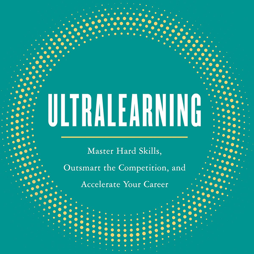

<p align="center">
  
</p>

<h1 align="center">⚡ Ultralearning</h1>

<p align="center">
  <strong>An agentic skills framework bringing Scott Young's Ultralearning methodology to AI coding agents.</strong>
</p>

<p align="center">
  <a href="https://opensource.org/licenses/MIT"></a>
  <a href="https://github.com/leokao0806/ultralearning"></a>
</p>

> [!NOTE]
> **Attribution:** This project is an open-source AI agent skill implementation of the **Ultralearning** framework created by **Scott H. Young** in his book *[Ultralearning: Master Hard Skills, Outsmart the Competition, and Accelerate Your Career](https://www.scotthyoung.com/blog/ultralearning/)* (Harper Business, 2019). All core pedagogical principles and methodologies are the intellectual work of Scott H. Young.

---

Turn vague desires (*"I want to learn Go"* or *"I want to master machine learning"*) into high-velocity, milestone-driven blueprints optimized for maximum retention and direct real-world transfer.

---

## 🎯 Key Capabilities

* **Metalearning & CFP Decomposition:** Breaks any subject into **Concepts** (to understand via Feynman technique), **Facts** (to memorize via Anki/SRS), and **Procedures** (to master via deliberate drills).
* **The 10% Research Rule:** Prevents analysis paralysis by bounding preparatory research to 10% of total planned hours.
* **Directness-First Strategy:** Eliminates "tutorial hell" by anchoring study plans directly in real-world deliverables (apps, papers, benchmarks).
* **Direct-Then-Drill Cycles:** Detects rate-limiting bottlenecks and crafts isolated micro-drills (time-slicing, cognitive component isolation, copycatting).
* **Active Retrieval & Retention Architecture:** Enforces question-book note-taking, closed-book problem sets, and spaced repetition schedules.
* **Troubleshooting Engine:** Built-in diagnostic playbooks for procrastination, plateaus, leaky-bucket retention, and feedback avoidance.

---

## 🚀 Installation & Setup

Install this skill across any major AI Agent runtime:

### 1. Claude Code
Install directly as a plugin:
```bash
/plugin install leokao0806/ultralearning
```
*Or clone into your local skills directory:*
```bash
git clone https://github.com/leokao0806/ultralearning.git ~/.claude/skills/ultralearning
```

### 2. Antigravity (Google / Gemini)
Install the plugin directly via the CLI:
```bash
agy plugin install https://github.com/leokao0806/ultralearning
```

### 3. Cursor
Clone or submodule into your workspace `.cursor/rules` or project skills:
```bash
git clone https://github.com/leokao0806/ultralearning.git .agents/skills/ultralearning
```

### 4. OpenAI Codex / Other Coding Agents
Clone into the universal cross-runtime skills directory:
```bash
git clone https://github.com/leokao0806/ultralearning.git ~/.agents/skills/ultralearning
```

---

## 💡 How It Works

Once installed, simply prompt your agent:

> *"I want to design an intensive 6-week ultralearning project to master distributed systems in Go."*  
> *"Audit and optimize my current study plan using ultralearning principles."*

The agent activates `skills/ultralearning-planner/SKILL.md` and guides you through the 6-phase consultative engine:

```text
[Phase 1: Project Intake & Goal Calibration]
                │
                ▼
[Phase 2: Metalearning & CFP Decomposition]
                │
                ▼
[Phase 3: Directness & Drill Engine Design]
                │
                ▼
[Phase 4: Retrieval, Retention & Feedback Systems]
                │
                ▼
[Phase 5: Blueprint Generation & Schedule Assembly]
                │
                ▼
[Phase 6: Mid-Project Audit & Bottleneck Triage]
```

---

## 📂 Repository Layout

```text
.
├── .claude-plugin/              # Manifests for Claude Code
│   ├── plugin.json
│   └── marketplace.json
├── .antigravity-plugin/         # Manifest for Antigravity / Gemini
│   └── plugin.json
├── .cursor-plugin/              # Manifest for Cursor
│   └── plugin.json
├── .codex-plugin/               # Manifest for OpenAI Codex
│   └── plugin.json
├── skills/
│   └── ultralearning-planner/   # The core skill
│       ├── SKILL.md             # Main procedural prompt & execution rules
│       ├── references/
│       │   ├── principles-deep-dive.md        # Detailed breakdown of all 9 principles
│       │   └── troubleshooting-bottlenecks.md  # Diagnostic matrices for plateaus & blocks
│       └── resources/
│           ├── project-blueprint-template.md  # Standardized plan template
│           └── weekly-execution-tracker.md    # Deep work & Feynman struggle log
├── AGENTS.md                    # Universal agent onboarding rules
├── GEMINI.md                    # Entrypoint for Gemini
└── README.md
```

---

## 🧠 The 9 Principles of Ultralearning

1. **Metalearning:** Draw a map first. Spend 10% of time researching how the skill is structured.
2. **Focus:** Cultivate intense concentration; eliminate procrastination using the 5-minute rule.
3. **Directness:** Learn by doing the thing itself. Avoid passive proxy learning.
4. **Drill:** Attack the rate-limiting bottleneck with isolated component practice.
5. **Retrieval:** Test to learn. Closed-book recall over passive rereading.
6. **Feedback:** Don't dodge punches. Target the 80/20 difficulty sweet spot.
7. **Retention:** Don't fill a leaky bucket. Spaced repetition and proceduralization.
8. **Intuition:** Dig deep before building up. Enforce the 15-minute struggle timer and Feynman technique.
9. **Experimentation:** Explore outside comfort zones. A/B test methods and impose novel constraints.

---

## 📚 Attribution & Acknowledgments

This project is an open-source AI agent implementation inspired by and built directly upon the methodology developed by **Scott H. Young** in his bestselling book:

> **[*Ultralearning: Master Hard Skills, Outsmart the Competition, and Accelerate Your Career*](https://www.scotthyoung.com/blog/ultralearning/)**  
> by Scott H. Young (Harper Business, 2019)

All core pedagogical concepts, the 9 principles (Metalearning, Focus, Directness, Drill, Retrieval, Feedback, Retention, Intuition, Experimentation), and project structuring techniques are the intellectual work of Scott H. Young. This repository serves as an operational translation that equips autonomous AI coding agents (Claude Code, Antigravity, Cursor, Codex) to act as ultralearning coaches and curriculum architects for human learners.

We strongly encourage everyone using this skill to purchase and read the original book for the full depth of insights, historical case studies, and psychological nuances.

---

## 📄 License

MIT License © 2026 [Leo Kao](https://github.com/leokao0806). Feel free to adapt and share!
